# Simple Credential Manager (SCM) — Architectural & Agent Guide

This document details the system design, cryptographic implementation, storage model, application flow, and developer conventions of **Simple Credential Manager (SCM)** to assist developers and AI coding agents working on this repository.

---

## 1. High-Level Architecture

Simple Credential Manager provides a multi-interface architecture:
- **Presentation Layer**:
  - **Modern Desktop UI & Multi-Surface Presentation** (`PySide6` / Qt 6):
    - **Floating Command Palette** (`CommandPaletteDialog.py`): Raycast/Spotlight-style borderless search window summonable via global hotkey (`Ctrl+Shift+Space`), Enter-to-copy password with 30s auto-wipe, auto-dismiss on blur.
    - **Dedicated System Tray Popover** (`TrayPopoverWindow.py` & `SystemTrayManager.py`): 320px slim flyout anchored directly to the system tray with live TOTP countdowns, quick-access favorites, quick search, one-click vault lock, and in-place backend switching.
    - **Full 3-Pane Workstation Manager** (`ModernMainWindow.py`): Comprehensive 3-pane layout, dark/light theme, TOTP countdown arc widget, categories/tags, and password health auditing.
    - **Authentication-on-Demand**: Opening any surface when locked immediately prompts for the Master Password before revealing or decrypting secrets.
  - **Modern Interactive & Headless CLI** (`Typer` + `Rich`) supporting styled tables, subcommands (`interactive`, `list`, `get`, `add`, `totp`, `health`, `server`), and scriptable headless JSON output.
  - **Modern Web Dashboard & Server Mode** (`FastAPI` + `Uvicorn` + WebCrypto) with out-of-band device whitelisting, subtle 404 unauthorized defense, transport payload encryption, and reverse-proxy subpath support.
  - **Classic Fallback Interfaces**: Legacy Tkinter GUI (`--classic` / `--tkinter`) and numbered legacy CLI (`--legacy`).
- **Provider Abstraction Seam & Backend Switching**:
  - `VaultDataProvider` protocol decoupling presentation from persistence.
  - `LocalVaultProvider`: Wraps `SecretManagerService` for local SQLite WAL database operations (`vault.scmdb`).
  - `RemoteVaultProvider`: Communicates with remote SCM server daemon using client-side AES-256-GCM transport payload encryption, device enrollment tokens, and strict zero-trace offline defense.
  - **Safe In-Place Backend Switch**:
    - GUI: Right-click tray icon -> "Switch Backend..." or click "Switch Backend" in Tray popover, select Local Database or Remote Server, and specify endpoint URL. Forcefully locks active vault, zeroes RAM keys via `SecureBuffer`, and swaps data providers.
    - CLI / Launchers: Start with `--remote https://<server-host>:8080` (optionally combined with `--palette` or `--tray`).
    - **Strict Sovereign Isolation**: No silent data migration between backends. Each backend is an independent sovereign store; manual export/import (`.scmbackup` or CSV) can be performed if desired.
- **Business Logic Layer**: `SecretManagerService` as the single authoritative facade for credentials, auth, lockouts, import/export, and audit logging.
- **Storage Layer**: Dual-storage engine supporting high-performance row-level SQLite WAL database (`vault.scmdb`) and legacy file SerDe (`.simpleCredentialManager.secret` / `.simpleCredentialManager.metadata`).

```mermaid
flowchart TD
    subgraph UI_Layer ["Presentation Layer"]
        MCLI["Modern CLI (Typer + Rich)\n(dev/.../cli/ModernCli.py)"]
        MGUI["Modern Desktop UI (PySide6)\n(dev/.../ui/ModernMainWindow.py)"]
        LCLI["Legacy CLI\n(SimpleCredentialManagerCli.py)"]
        LGUI["Legacy Tkinter UI\n(SimpleCredentialManagerUi.py)"]
    end

    subgraph Service_Layer ["Core Service Layer"]
        Service["SecretManagerService\n(core/SecretManagerService.py)"]
        TOTP["TotpService\n(core/TotpService.py)"]
        Health["PasswordHealthService\n(core/PasswordHealthService.py)"]
        Audit["AuditLogger\n(utils/AuditLogger.py)"]
        Release["ReleaseUpdateService\n(core/ReleaseUpdateService.py)"]
        Clipboard["SecureClipboardManager\n(utils/SecureClipboardManager.py)"]
        Breach["BreachChecker\n(utils/BreachChecker.py)"]
    end

    subgraph Storage_Layer ["Persistence & Crypto Layer"]
        Codec["CodecUtils (KDF & Ciphers)\n(codec/CodecUtils.py)"]
        SecBuf["SecureBuffer (Zeroization)\n(utils/SecureBuffer.py)"]
        SQLite["SqliteVaultStorage (WAL Mode)\n(storage/SqliteVaultStorage.py)"]
        Migrator["StorageMigrator\n(storage/StorageMigrator.py)"]
        SerDe["SerDeUtils (Atomic Temp Files)\n(codec/SerDeUtils.py)"]
    end

    MCLI --> Service
    MGUI --> Service
    LCLI --> Service
    LGUI --> Service

    MGUI --> TOTP
    MGUI --> Health
    MCLI --> TOTP
    MCLI --> Health
    Health --> Breach
    MGUI --> Clipboard
    MCLI --> Clipboard

    Service --> Codec
    Service --> SQLite
    Service --> SerDe
    Service --> Audit
    Service --> Release
    Migrator --> SQLite
    Migrator --> SerDe

    SQLite --> DBFile[("~/.simpleCredentialManager/vault.scmdb")]
    SerDe --> VaultFile[("~/.simpleCredentialManager/.simpleCredentialManager.secret")]
    SerDe --> MetaFile[("~/.config/.simpleCredentialManager/.simpleCredentialManager.metadata")]
    Audit --> AuditFile[("~/.config/.simpleCredentialManager/.simpleCredentialManager.audit.log")]
```



### Core Design Rules
- **Decoupled Interfaces**: Both UI and CLI communicate exclusively through `SecretManagerService`. Presentation code does not manipulate storage files or cryptographic master keys directly.
- **Local-Only Storage**: Vault data resides strictly on the local machine under the user's home directory (`~/.simpleCredentialManager` and `~/.config/.simpleCredentialManager`). Zero external cloud dependencies.
- **Zero-Trace Memory Hygiene**: Plaintext credentials only exist transiently in process memory when the vault is unlocked, backed by `SecureBuffer` zeroization and auto-lock upon 60 seconds of inactivity.

---

## 2. Directory & Path Layout

Defined in `dev/abhishekraha/secretmanager/config/SecretManagerConfig.py`:

| Constant / Path | Destination | Description |
|---|---|---|
| `APP_HOME_DIR` | `~/.simpleCredentialManager/` | Primary data directory |
| `APP_CONFIG_DIR` | `~/.config/.simpleCredentialManager/` | Metadata, configuration, and audit logs |
| `VAULT_DB_FILE` | `~/.simpleCredentialManager/vault.scmdb` | Primary SQLite WAL database (row-level AEAD) |
| `SECRET_FILE` | `~/.simpleCredentialManager/.simpleCredentialManager.secret` | Encrypted legacy JSON vault file |
| `SECRET_MANAGER_META_DATA` | `~/.config/.simpleCredentialManager/.simpleCredentialManager.metadata` | Legacy metadata, salt, verifier, lockout state |
| `AUDIT_LOG_FILE` | `~/.config/.simpleCredentialManager/.simpleCredentialManager.audit.log` | JSONL append-only audit trail |
| `DEFAULT_EXPORT_CSV` | `~/.simpleCredentialManager/secrets_export.csv` | Default plaintext CSV export location |
| `DEFAULT_ENCRYPTED_BACKUP` | `~/.simpleCredentialManager/secrets_backup.scmbackup` | Default encrypted backup location |
| `RELEASE_STATUS_CACHE_FILE`| `~/.config/.simpleCredentialManager/.simpleCredentialManager.release-status.json` | Cached GitHub release state |

---

## 3. Cryptography & Security Architecture

### Key Derivation & Two-Tier Envelope Encryption
Implemented in `CodecUtils.py` and `SqliteVaultStorage.py`:

1. **Master Key (KM) Derivation**:
   - Algorithm: **Argon2id** (`argon2.low_level.hash_secret_raw` with $m = 65536\text{ KB} / 64\text{ MB}$, $t = 3$, $p = 4$, hash length 32 bytes) when `argon2-cffi` is available.
   - Fallback: **Scrypt** KDF ($N = 16384, r = 8, p = 1$, 32 bytes) if Argon2 is unavailable.
2. **Two-Tier Envelope Key Hierarchy**:
   - **KEK (Key Encryption Key)**: Derived from KM via `HKDFExpand(SHA256, info=b"scm-envelope-kek-v1", length=32)`.
   - **Auth Key**: Derived from KM via `HKDFExpand(SHA256, info=b"scm-envelope-auth-v1", length=32)`.
   - **DEK (Data Encryption Key)**: A cryptographically random 256-bit Fernet key wrapped under KEK using `AES-256-GCM` with a 96-bit random nonce.
   - **Blind Index Key**: Derived from DEK via `HKDFExpand(SHA256, info=b"scm-blind-index-key-v1", length=32)` for privacy-preserving $O(1)$ lookups.
3. **Legacy Split Material Strategy (`v4` Format)**:
   - Derives 64 bytes via Scrypt: First 32 bytes as `password_verifier` (stored in `.metadata` for constant-time `hmac.compare_digest`), second 32 bytes as `vault_key` (Fernet key).
4. **Data Encryption**:
   - Row-level secrets are encrypted with Fernet (AES-128-CBC + HMAC-SHA256) or AES-256-GCM under the DEK.

### Memory Hygiene (`SecureBuffer`)
- Implemented in `dev/abhishekraha/secretmanager/utils/SecureBuffer.py`.
- Provides context-managed mutable `bytearray` buffers with explicit C-style `memset` memory zeroing (`sb.zero()` / `sb.clear()`) to wipe sensitive bytes from RAM upon exit.

### Zero-Trace Clipboard Protection (`SecureClipboardManager`)
- Implemented in `dev/abhishekraha/secretmanager/utils/SecureClipboardManager.py`.
- Sets OS-level privacy exclusion flags (`ExcludeClipboardContentFromMonitorProcessing` / `ClipboardViewerIgnore` on Windows; `org.nspasteboard.ConcealedType` on macOS) to prevent clipboard history sniffers and cloud sync from logging credentials.
- Automates memory wipe with a guaranteed 30-second cancellation timer.

### Inactivity Auto-Lock
- Configured by `SESSION_IDLE_LOCK_SECONDS = 60`.
- The Modern UI tracks window focus and user input events, while the CLI uses input timeouts (`timed_input`).
- When idle for 60 seconds, the active session is cleared: `DERIVED_KEY` is zeroed via `CodecUtils.clear_derived_key()` and decrypted secrets are purged from RAM.

### Persistent Lockout & Fresh Vault Wipe
- Failed attempts threshold: 3 failures (`FAILED_AUTH_LOCKOUT_THRESHOLD = 3`).
- Exponential backoff: Base 30s (`FAILED_AUTH_LOCKOUT_BASE_SECONDS = 30`), scaling up to 15 minutes (`FAILED_AUTH_LOCKOUT_MAX_SECONDS = 900`).
- Lockout counter and expiration timestamps are stored inside `vault_meta` / `.metadata` to survive process restarts.
- **Reset Vault & Wipe All**: After 3 failed attempts, users can initiate a fresh wipe via `reset_vault_and_wipe_all()`. Requires explicit confirmation (`"WIPE"`) to securely delete databases, metadata, and backup artifacts.

---

## 4. Storage Engines & Data Models

### Dual Storage Engine

1. **SQLite Storage Engine (`SqliteVaultStorage`)**:
   - Primary database file: `~/.simpleCredentialManager/vault.scmdb`.
   - SQLite Write-Ahead Logging (`PRAGMA journal_mode = WAL;`) for atomic crash resilience.
   - Schema:
     - `vault_meta`: `version`, `salt`, `kdf_algorithm`, `kdf_params`, `wrapped_dek`, `lockout_data`, `created_at`, `preferred_ui`.
     - `secrets`: `id`, `blind_index` (HMAC-SHA256 of lowercase name), `name_encrypted`, `username_encrypted`, `payload_encrypted`, `category`, `is_favorite`, `created_at`, `updated_at`.
2. **File SerDe Engine (`SerDeUtils`)**:
   - Fallback/Legacy storage: `.simpleCredentialManager.secret` and `.simpleCredentialManager.metadata`.
   - Writes are performed atomically using a `.tmp` file in the destination folder, flushed, and replaced via `os.replace`.
3. **Storage Migration (`StorageMigrator`)**:
   - Seamlessly migrates legacy file-based vaults (`.secret` + `.metadata`) into SQLite (`vault.scmdb`) upon authentication.

### `Secret` Model (`dev/abhishekraha/secretmanager/model/Secret.py`)
Fields:
- `name` (string, primary lookup key)
- `username` (string)
- `password` (string)
- `url` (string, optional)
- `comments` (string, optional)
- `category` (string, default `"login"`, e.g., `"login"`, `"card"`, `"note"`, `"server"`)
- `is_favorite` / `favorite` (boolean, default `False`)
- `totp_secret` (string, optional base32 TOTP key or `otpauth://` URI)
- `tags` (list of strings, optional)
- `create_date` (datetime / ISO string)
- `update_date` (datetime / ISO string, nullable)

Key Methods: `to_dict()`, `from_dict()`, `has_totp()`, getters and setters for all fields.

---

## 5. Helper Services & Modules

### 1. `TotpService` (`dev/abhishekraha/secretmanager/core/TotpService.py`)
- Standard RFC 6238 TOTP computation.
- Functions:
  - `generate_totp(secret_or_uri, timestamp=None, step=30, digits=6, algorithm="sha1") -> str`
  - `verify_totp(secret_or_uri, candidate_code, window=1, step=30, digits=6) -> bool`
  - `get_remaining_seconds(timestamp=None, step=30) -> int`
  - `parse_secret(raw_secret_or_uri) -> str`: Normalizes base32 or extracts secret from `otpauth://` URI.
  - `parse_uri_metadata(uri_string) -> dict`: Extracts issuer, account, digits, step, and algorithm.

### 2. `PasswordHealthService` (`dev/abhishekraha/secretmanager/core/PasswordHealthService.py`)
- Vault security analytics:
  - `audit_vault(secrets_list, check_breaches=False, breach_timeout=3) -> dict`: Analyzes weak passwords, reused passwords, stale credentials (>90 days), and optionally queries breach status.
  - `is_weak_password(password) -> tuple[bool, str]`: Validates length ($\ge 12$) and character entropy ($\ge 50$ bits).
  - `calculate_health_score(total_secrets, weak_count, reused_count, stale_count, breached_count=0) -> int`: Returns overall vault health score (0–100).
  - `check_hibp_breach(password, timeout=3) -> tuple[bool, int]`: Privacy-preserving k-anonymity check.

### 3. `BreachChecker` (`dev/abhishekraha/secretmanager/utils/BreachChecker.py`)
- Checks passwords against HaveIBeenPwned range API using k-anonymity:
  - `check_password_breach(password, timeout=3) -> tuple[bool, int]`
  - Computes SHA-1 hash, sends only first 5 hex chars (`prefix`), compares remainder (`suffix`) locally. Plaintext or full hash never leaves the host.

### 4. `SecureClipboardManager` (`dev/abhishekraha/secretmanager/utils/SecureClipboardManager.py`)
- `copy(text, clear_timeout_seconds=30, enable_privacy=True)`: Copies secret to system clipboard, applies OS privacy tags, and schedules automatic zero-trace clearance.
- `cancel_active_timer()`: Cancels any active scheduled clipboard wipe.

### 5. `ReleaseUpdateService` (`dev/abhishekraha/secretmanager/core/ReleaseUpdateService.py`)
- Checks GitHub API for updates, caches status, alerts on outdated versions, and supports in-place self-upgrading.

### 6. SCM Server Modules (`dev/abhishekraha/secretmanager/server/`)
- **`ServerApp.py`**: FastAPI application factory (`create_app`) mounting REST endpoints, subtle 404 gatekeeper middleware, transport payload decryption, and zero-dependency SPA dashboard.
- **`DeviceRegistry.py`**: Out-of-band physical device whitelisting, enrollment token generation/rotation, device registration, and host-driven CLI approval/revocation.
- **`SessionManager.py`**: In-memory ephemeral session tokens with 60-second inactivity auto-lock and cryptographic zeroization.
- **`TransportCrypto.py`**: Device-bound AES-256-GCM request encryption routines keyed via HKDF-SHA256 derived from approved device tokens.

### 7. Multi-Surface Presentation & Backend Switching Modules (`dev/abhishekraha/secretmanager/ui/` & `providers/`)
- **`CommandPaletteDialog.py`**: Frameless 640px floating command palette summoned system-wide via `Ctrl+Shift+Space` (or macOS `Cmd+Shift+Space`). Performs fuzzy real-time searching, Enter-to-copy password with 30s auto-wipe, `Ctrl+T` to copy TOTP, `Ctrl+O` to open full detail view. Enforces authentication-on-demand if invoked while vault is locked.
- **`TrayPopoverWindow.py`**: Slim 320px popover anchored directly to the system tray geometry. Provides live backend connection status, quick search, favorite items with per-second live TOTP countdowns, and quick lock. Enforces authentication-on-demand before displaying credentials.
- **`SystemTrayManager.py`**: Persistent system tray icon controller (`QSystemTrayIcon`). Handles single-click popover trigger, double-click full workstation window activation, one-click vault lock, and in-place backend switching (`switch_backend()`) between Local Database and Remote SCM Server.
- **`ModernMainWindow.py`**: 3-pane workstation management window displaying credential categories, tags, security health meters, and real-time TOTP countdown arc widget.
- **`VaultDataProvider.py` / `LocalVaultProvider.py` / `RemoteVaultProvider.py`**: Seam decoupling UI widgets from SQLite WAL storage or remote encrypted HTTP endpoints. Backend switching safely locks the active provider, zeroes active memory keys, and swaps provider instances across all surfaces without automatic data migration.

---

## 7. Authoritative `SecretManagerService` Method Signatures

When modifying or calling `SecretManagerService` (`dev/abhishekraha/secretmanager/core/SecretManagerService.py`), AI agents must adhere strictly to the following method signatures:

```python
class SecretManagerService:
    def __init__(self, client_name: str = "unknown"): ...
    def initialize(self) -> bool: ...
    def is_initialized(self) -> bool: ...
    def is_unlocked(self) -> bool: ...
    def setup_master_password(self, master_password: str, confirmation_password: str) -> None: ...
    def authenticate(self, master_password: str) -> tuple[bool, str]: ...
    def get_lockout_status(self) -> dict: ...
    def change_master_password(self, current_password: str, new_password: str, confirmation_password: str) -> None: ...
    def lock_vault(self) -> None: ...
    def reset_vault_and_wipe_all(self) -> None: ...

    # Secret Operations
    def add_secret(
        self,
        name: str,
        username: str,
        password: str,
        url: str = "",
        comments: str = "",
        category: str = "login",
        is_favorite: bool = False,
        totp_secret: Optional[str] = None,
        tags: Optional[list] = None,
    ) -> None: ...

    def update_secret(
        self,
        original_name: str,
        new_name: Optional[str] = None,
        username: Optional[str] = None,
        password: Optional[str] = None,
        url: str = "",
        comments: str = "",
        category: Optional[str] = None,
        is_favorite: Optional[bool] = None,
        totp_secret: Optional[str] = None,
        tags: Optional[list] = None,
    ) -> None: ...

    def delete_secret(self, name: str) -> None: ...
    def get_secret(self, secret_name: str) -> Optional[Secret]: ...
    def get_secret_records(self, filter_text: str = "") -> list[Secret]: ...
    def get_secret_names(self, filter_text: str = "") -> list[str]: ...
    def generate_password(self, length: int = 20) -> str: ...
    def bulk_insert_secrets(self, csv_payload: str) -> dict: ...

    # Import / Export
    def detect_import_format(self, source_path: Union[str, Path]) -> str: ...
    def export_secrets(self, target_path: Union[str, Path], overwrite: bool = False) -> Path: ...
    def import_secrets(self, source_path: Union[str, Path], conflict_strategy: str = "skip", rename_resolver: Optional[Callable] = None) -> dict: ...
    def export_encrypted_backup(self, target_path: Union[str, Path] = DEFAULT_ENCRYPTED_BACKUP, backup_password: str = "", overwrite: bool = False) -> Path: ...
    def import_encrypted_backup(self, source_path: Union[str, Path], backup_password: str, conflict_strategy: str = "skip", rename_resolver: Optional[Callable] = None) -> dict: ...

    # Audit & Preferences
    def record_secret_view(self, secret_name: str) -> None: ...
    def record_secret_copy(self, secret_name: str, field_name: str = "password") -> None: ...
    def record_secret_listing(self, result_count: int, filter_applied: bool = False) -> None: ...
    def get_ui_preference(self) -> str: ...  # "modern" or "classic"
    def set_ui_preference(self, ui_type: str) -> None: ...
    def get_startup_recovery_instructions(self, error: Exception) -> list[str]: ...
```

---

## 8. Launcher Scripts & Binary Builders

### User Launchers (`scripts/launchers/`)
Convenient wrapper scripts that auto-check dependencies and launch the default interface:
- **`scripts/launchers/SimpleCredentialManagerUi.bat`**: Windows launcher for Modern GUI (with Tkinter fallback).
- **`scripts/launchers/SimpleCredentialManagerUi.sh`**: POSIX launcher for Modern GUI.
- **`scripts/launchers/SimpleCredentialManagerCli.bat`**: Windows launcher for Modern Typer CLI in a new terminal.
- **`scripts/launchers/SimpleCredentialManagerCli.sh`**: POSIX launcher for Modern CLI.

Launcher arguments supported by `SimpleCredentialManagerUi.py`:
- `--remote https://<server-host>:8080`: Connects the desktop client to a remote SCM server.
- `--palette`: Launches directly into the Floating Command Palette.
- `--tray`: Launches minimized to the System Tray Daemon.
- `--tkinter` / `--classic`: Forces fallback Tkinter classic interface.

### Standalone Local Builders (`scripts/local-builder/`)
Automated PyInstaller scripts that compile standalone binaries embedding Python and all cryptography C-extensions:
- **`scripts/local-builder/build-windows.bat`** & **`build-windows.ps1`**: Produces `dist/scm.exe` and `dist/SimpleCredentialManagerUi.exe`.
- **`scripts/local-builder/build-unix.sh`**: Produces `dist/scm` and `dist/SimpleCredentialManagerUi` on macOS/Linux.

---

## 9. Development & Testing Conventions

### Running Unit Tests
All tests are implemented using Python's built-in `unittest` framework:
```bash
python -m unittest discover tests
```
*Note: Ensure all 112+ tests pass before committing any changes.*

### Code Structure
- Core package root: `dev/abhishekraha/secretmanager/`
- All cross-interface business logic must reside in `core/SecretManagerService.py`. Never implement business logic directly in UI widgets or CLI commands.
- Presentation code in `dev/abhishekraha/secretmanager/ui/` (PySide6) or `dev/abhishekraha/secretmanager/cli/` (Typer/Rich) should only call `SecretManagerService` methods.
- Cryptographic code in `codec/CodecUtils.py` and `storage/SqliteVaultStorage.py` must use secure constant-time equality checks and clean up keys via `SecureBuffer` or `zero_buffer`.
