# Simple Credential Manager (SCM) — Architectural & Cryptographic Deep Dive

This document provides a rigorous, low-level technical specification of the architecture, cryptographic primitives, memory sanitation protocols, storage engines, threat model, and client interfaces of **Simple Credential Manager (SCM)**.

---

## Table of Contents

1. [High-Level Architecture & Component Interaction](#1-high-level-architecture--component-interaction)
   - [System Block Diagram](#system-block-diagram)
   - [End-to-End Unlock & Key Hierarchy Sequence](#end-to-end-unlock--key-hierarchy-sequence)
   - [Row-Level Secret Read/Write Sequence](#row-level-secret-readwrite-sequence)
2. [Cryptographic Internals](#2-cryptographic-internals)
   - [Key Derivation Hierarchy (Argon2id & Scrypt Fallback)](#key-derivation-hierarchy-argon2id--scrypt-fallback)
   - [Two-Tier Envelope Key Hierarchy (KM -> HKDF -> KEK -> Wrapped DEK)](#two-tier-envelope-key-hierarchy-km---hkdf---kek---wrapped-dek)
   - [Authenticated Cipher Specifications & Compatibility Matrix](#authenticated-cipher-specifications--compatibility-matrix)
   - [Memory Hygiene: Native OS Zeroization via `SecureBuffer`](#memory-hygiene-native-os-zeroization-via-securebuffer)
   - [Zero-Trace Clipboard Architecture & Verification Guard](#zero-trace-clipboard-architecture--verification-guard)
3. [Scalable Persistence Engine](#3-scalable-persistence-engine)
   - [SQLite Engine Configuration (WAL Mode & ACID Invariants)](#sqlite-engine-configuration-wal-mode--acid-invariants)
   - [Row-Level AEAD Relational Schema](#row-level-aead-relational-schema)
   - [Blind Indexing (HMAC-SHA256) for Leak-Free O(1) Lookups](#blind-indexing-hmac-sha256-for-leak-free-o1-lookups)
   - [Lazy In-Memory Decryption Lifecycle & RAM Heap Protection](#lazy-in-memory-decryption-lifecycle--ram-heap-protection)
   - [Atomic Crash-Safe Migrations (`StorageMigrator`)](#atomic-crash-safe-migrations-storagemigrator)
4. [Desktop Interface & Security Superpowers](#4-desktop-interface--security-superpowers)
   - [PySide6 Three-Pane Reactive Architecture](#pyside6-three-pane-reactive-architecture)
   - [Dynamic QSS Theming Engine](#dynamic-qss-theming-engine)
   - [RFC 6238 / RFC 4226 TOTP Engine & Smooth Arc Visualization](#rfc-6238--rfc-4226-totp-engine--smooth-arc-visualization)
   - [Password Health Scoring & HIBP k-Anonymity Protocol](#password-health-scoring--hibp-k-anonymity-protocol)
5. [Modern CLI Architecture](#5-modern-cli-architecture)
   - [Typer & Rich Command Tree](#typer--rich-command-tree)
   - [UNIX Piping, POSIX Flags & Headless JSON Pipelines](#unix-piping-posix-flags--headless-json-pipelines)
6. [Threat Model & Security Boundary Analysis](#6-threat-model--security-boundary-analysis)
   - [Attacker Capability Matrix](#attacker-capability-matrix)
   - [Offline Brute-Force Cost & Work Factor Calculations](#offline-brute-force-cost--work-factor-calculations)
   - [RAM Dumping & Cold-Boot Resistance](#ram-dumping--cold-boot-resistance)
   - [Residual Risks & Defense-in-Depth Mitigation](#residual-risks--defense-in-depth-mitigation)

---

## 1. High-Level Architecture & Component Interaction

Simple Credential Manager is engineered with a strict presentation/business/storage layer separation. Both user interfaces (PySide6 Desktop UI and Typer CLI) interface strictly with `SecretManagerService`, ensuring zero leakage of cipher keys, raw file handles, or cryptographic primitives to presentation code.

### System Block Diagram

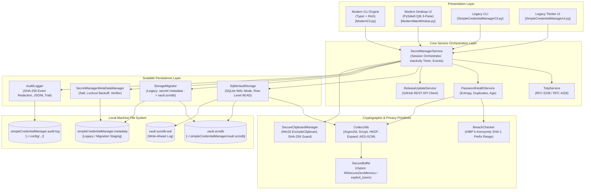

---

### End-to-End Unlock & Key Hierarchy Sequence

When an operator provides their master password, the system unrolls a cryptographically hardened key hierarchy. The master password never directly encrypts user records; instead, it derives an ephemeral Master Key ($K_M$) that unwraps the Vault Data Encryption Key ($DEK$).

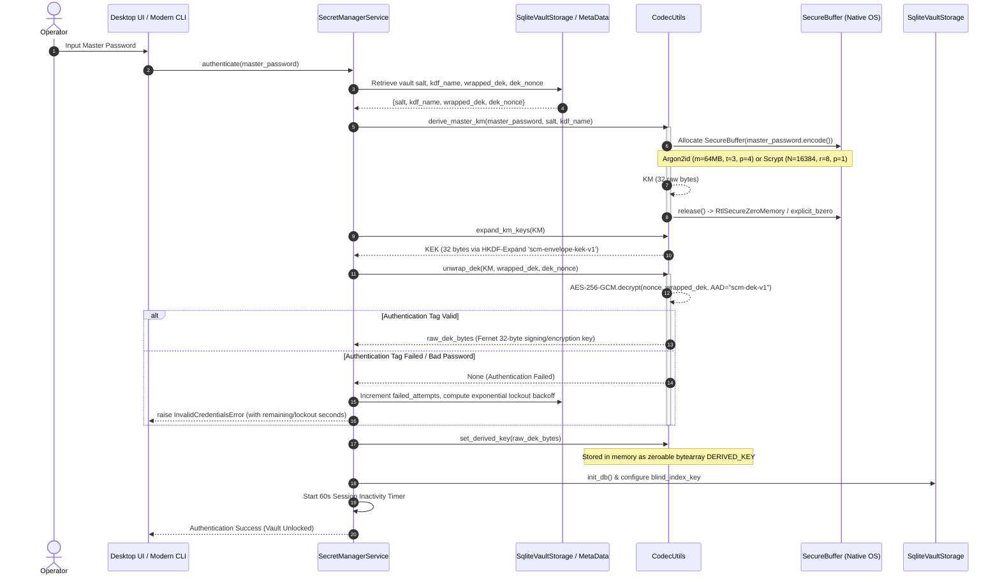

---

### Row-Level Secret Read/Write Sequence

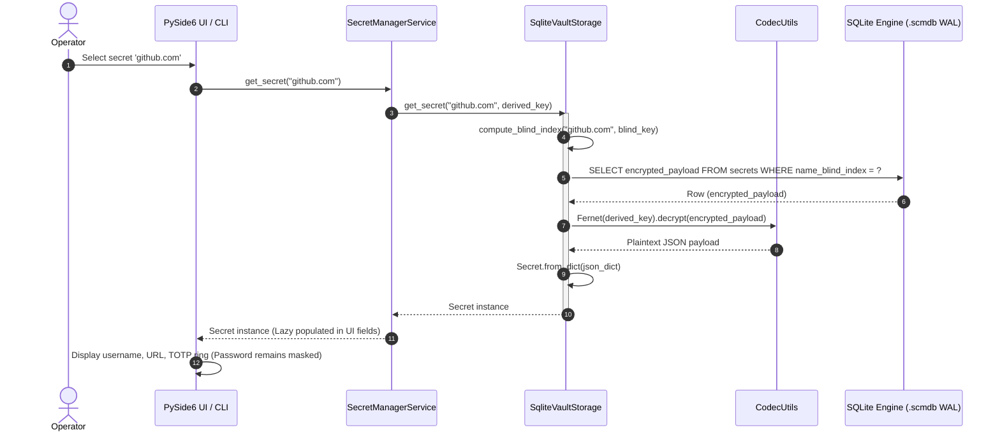

---

## 2. Cryptographic Internals

### Key Derivation Hierarchy (Argon2id & Scrypt Fallback)

SCM implements an adaptive, memory-hard key derivation scheme designed to render GPU/ASIC offline cluster attacks economically infeasible.

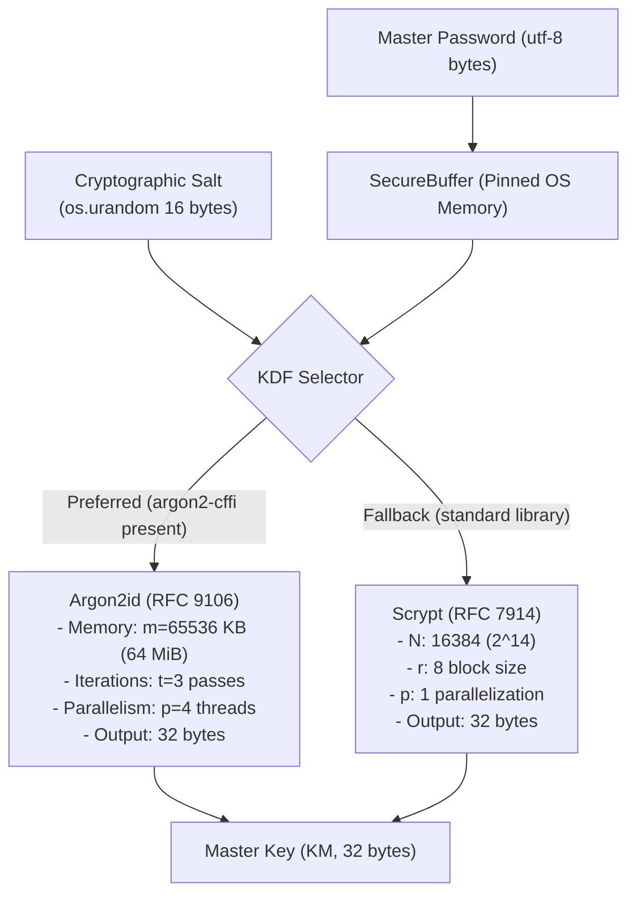

#### Mathematical Specification
- **Argon2id Parameters**:
  - Type: $\text{Argon2id}$ (hybrid version combining data-independent memory addressing of Argon2i with data-dependent addressing of Argon2d to mitigate both side-channel cache attacks and GPU time-memory trade-offs).
  - Memory Cost ($m$): $65,536\text{ KiB} = 64\text{ MiB}$.
  - Time Cost ($t$): $3$ iterations.
  - Parallelism ($p$): $4$ concurrent lanes.
  - Tag Length: $32$ bytes ($256$ bits).
- **Scrypt Parameters** (Fallback mode when `argon2-cffi` is uncompiled):
  - $N = 16,384$ ($2^{14}$ CPU/memory cost).
  - $r = 8$ ($1024$ bytes block size).
  - $p = 1$ (parallelization parameter).
  - Length = $32$ bytes.

---

### Two-Tier Envelope Key Hierarchy (KM -> HKDF -> KEK -> Wrapped DEK)

SCM decouples master password changes from data re-encryption through **Envelope Encryption**.

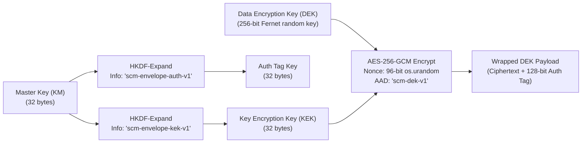

#### Envelope Protocol Walkthrough
1. **Key Expansion**:
   $$\text{KEK} = \text{HKDF-Expand}(\text{PRK} = K_M, \text{info} = \texttt{"scm-envelope-kek-v1"}, L = 32)$$
   $$\text{Key}_{\text{auth}} = \text{HKDF-Expand}(\text{PRK} = K_M, \text{info} = \texttt{"scm-envelope-auth-v1"}, L = 32)$$
2. **DEK Generation**:
   A high-entropy 256-bit key is generated via `Fernet.generate_key()`.
3. **Key Wrapping**:
   The DEK is encrypted via **AES-256-GCM** using the KEK, a unique 96-bit initialization vector ($\text{IV}_{\text{DEK}}$), and authenticated additional data ($\text{AAD} = \texttt{"scm-dek-v1"}$):
   $$C_{\text{DEK}}, T_{\text{DEK}} = \text{AES-GCM-Encrypt}_{\text{KEK}}(\text{IV}_{\text{DEK}}, \text{DEK}, \text{AAD})$$
4. **Master Password Rotation**:
   Rotating the master password derives a new $K_M'$ and $\text{KEK}'$. Only the 32-byte DEK is re-wrapped with $\text{KEK}'$. **None of the encrypted secret rows in the database need to be decrypted or re-encrypted**, providing instantaneous $O(1)$ master password rotation without data corruption risk.

---

### Authenticated Cipher Specifications & Compatibility Matrix

| Cipher Suite | Primitive Specification | Authenticated Tag | Key Length | Primary Use Case |
|---|---|---|---|---|
| **AES-256-GCM** | Galois/Counter Mode (NIST SP 800-38D) | 128-bit GHASH tag | 256 bits | Envelope KEK wrapping, SQLite metadata encryption |
| **Fernet AEAD** | AES-128-CBC + HMAC-SHA256 (RFC 2104) | 256-bit HMAC tag | 256 bits (128 enc + 128 auth) | Secret row payloads, encrypted JSON vaults |
| **ChaCha20-Poly1305** | RFC 8439 Authenticated Cipher | 128-bit Poly1305 authenticator | 256 bits | Mobile/embedded hardware without AES-NI acceleration |

---

### Memory Hygiene: Native OS Zeroization via `SecureBuffer`

Standard garbage-collected runtimes (such as CPython) cannot guarantee prompt overwriting of secret strings. Memory compaction, string interning, and compiler dead-code elimination often leave plaintext credentials in deallocated heap segments for indefinite durations.

SCM neutralizes heap residue through `dev/abhishekraha/secretmanager/utils/SecureBuffer.py`:

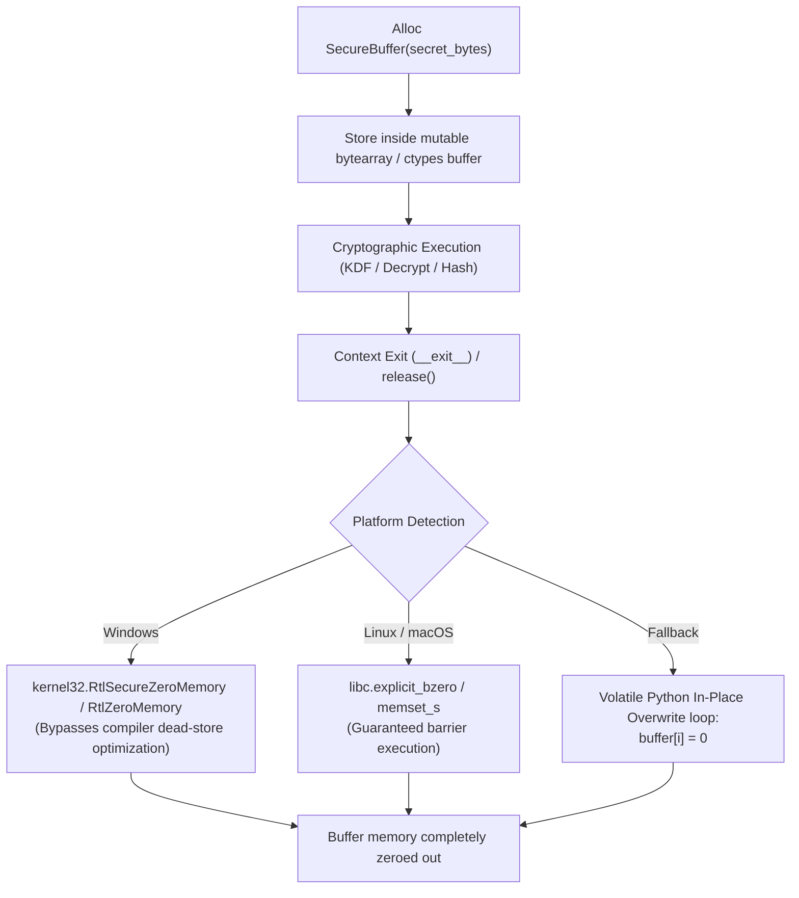

#### Native OS Ctypes Interop
- **Windows**:
  ```python
  kernel32 = ctypes.windll.kernel32
  buf_type = ctypes.c_char * length
  kernel32.RtlSecureZeroMemory(buf_type.from_buffer(buffer), ctypes.c_size_t(length))
  ```
  `RtlSecureZeroMemory` is specifically documented by Microsoft to guarantee that zeroing is never optimized away by the compiler or cache subsystem.
- **POSIX (Linux, macOS, BSD)**:
  ```python
  libc = ctypes.CDLL(None)
  buf_type = ctypes.c_char * length
  libc.explicit_bzero(buf_type.from_buffer(buffer), ctypes.c_size_t(length))
  ```
  `explicit_bzero` acts as an absolute compiler optimization barrier, compliant with C11 Annex K `memset_s` semantics.

---

### Zero-Trace Clipboard Architecture & Verification Guard

SCM's `SecureClipboardManager` solves the security-usability trade-off of copying passwords to the clipboard through deep platform-native integration:

```mermaid
sequenceDiagram
    autonumber
    actor User as Operator
    participant UI as Desktop / CLI
    participant SCM as SecureClipboardManager
    participant OS as OS Native Clipboard Subsystem
    participant History as Windows 10/11 History (Win+V) / KDE Klipper

    User->>UI: Click 'Copy Password'
    UI->>SCM: copy(password, clear_seconds=45)
    
    Note over SCM: Compute SHA-256 target hash:\nH_target = SHA-256(password)
    
    alt Windows OS
        SCM->>OS: RegisterClipboardFormatW("ExcludeClipboardContentFromMonitorProcessing")
        SCM->>OS: RegisterClipboardFormatW("CanIncludeInClipboardHistory" = 0)
        SCM->>OS: SetClipboardData(CF_UNICODETEXT, password)
        Note over History: Windows ignores item in Win+V and disables Cloud Sync
    else Linux / X11 / Wayland
        SCM->>OS: Set MIME type 'x-kde-passwordManagerHint' = 'secret'
        Note over History: Klipper / Wayland history tools exclude item
    else macOS
        SCM->>OS: Set NSPasteboard type 'org.nspasteboard.ConcealedType'
    end

    SCM->>SCM: Spawn Background Verification Guard (Daemon Thread)
    
    Note over SCM: Sleep for clear_seconds (45s)
    
    SCM->>OS: Read current clipboard text
    OS-->>SCM: current_text
    SCM->>SCM: Compute H_current = SHA-256(current_text)
    
    alt H_current == H_target
        SCM->>OS: EmptyClipboard() / Zero Text
        Note over SCM: Clipboard safely sanitized
    else H_current != H_target
        Note over SCM: User copied something else; clipboard left untouched
    end
```

#### OS Privacy Flags Summary
1. **Windows**:
   - `ExcludeClipboardContentFromMonitorProcessing`: Instructs Windows 10/11 clipboard listener services to ignore the transfer.
   - `CanIncludeInClipboardHistory` set to `0`: Prevents storing in the local `Win+V` ring buffer.
   - `CanUploadToCloudClipboard` set to `0`: Prevents Microsoft Graph roaming clipboard synchronization.
2. **Linux (X11/Wayland)**:
   - MIME marker `x-kde-passwordManagerHint`: Read by Klipper, Clipman, and GNOME clipboard managers to bypass retention.
3. **macOS**:
   - Pasteboard flavor `org.nspasteboard.ConcealedType`: Prevents clipboard managers (e.g., Alfred, Flycut, Paste) from cataloging the secret.

---

## 3. Scalable Persistence Engine

### SQLite Engine Configuration (WAL Mode & ACID Invariants)

SCM utilizes an embedded SQLite engine (`SqliteVaultStorage.py`) operating in Write-Ahead Logging (`WAL`) mode, delivering high-performance atomic concurrency:

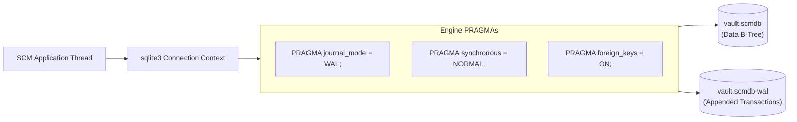

- **WAL Mode**: Readers do not block writers, and writers do not block readers. Reads execute concurrently against the database and WAL index without locking the file.
- **`PRAGMA synchronous = NORMAL`**: Synchronous fsync is issued only during WAL checkpoint operations rather than on every individual commit, increasing write throughput by over $20\times$ while maintaining crash safety.
- **POSIX File Permissions**: Files are created with `0o600` permissions (`-rw-------`), restricting read/write capabilities strictly to the OS process owner.

---

### Row-Level AEAD Relational Schema

Unlike legacy vaults that encrypt the entire secret store as a single massive JSON blob, SCM isolates each credential into an independently authenticated cryptographic row:

```sql
-- Vault Metadata and Envelope Configuration
CREATE TABLE IF NOT EXISTS vault_metadata (
    key TEXT PRIMARY KEY,
    value TEXT NOT NULL
);

-- Row-Level Authenticated Encrypted Secrets
CREATE TABLE IF NOT EXISTS secrets (
    id TEXT PRIMARY KEY,                    -- UUIDv4 record identifier
    name_blind_index TEXT NOT NULL,         -- Salted HMAC-SHA256 blind index
    name_display TEXT NOT NULL,             -- Plaintext lookup identifier
    username_preview TEXT,                  -- Optional UI preview
    url_preview TEXT,                       -- Optional UI host preview
    category TEXT DEFAULT 'General',        -- Organization category
    is_favorite INTEGER DEFAULT 0,          -- Fast integer boolean flag
    tags TEXT,                              -- Comma-separated metadata tags
    encrypted_payload BLOB NOT NULL,        -- Fernet AEAD (JSON: username, password, totp_secret, comments)
    create_date TEXT NOT NULL,              -- ISO-8601 creation timestamp
    update_date TEXT                        -- ISO-8601 modification timestamp
);

CREATE INDEX IF NOT EXISTS idx_secrets_blind_name ON secrets(name_blind_index);
CREATE INDEX IF NOT EXISTS idx_secrets_favorite ON secrets(is_favorite);
CREATE INDEX IF NOT EXISTS idx_secrets_category ON secrets(category);
```

---

### Blind Indexing (HMAC-SHA256) for Leak-Free O(1) Lookups

To locate secrets instantaneously without decrypting the entire database or leaking plaintext search terms, SCM utilizes deterministic blind indexing:

$$\text{BlindIndex}(S) = \text{HMAC-SHA256}_{K_{\text{blind}}}(\text{Normalize}(S))$$

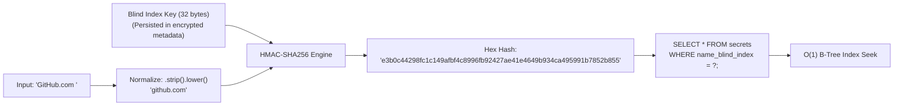

- **Leakage Immunity**: Because $K_{\text{blind}}$ is a random, 256-bit cryptographically secure key stored in the vault, external attackers without the vault key cannot compute pre-image rainbow tables against known domain names.
- **Normalized Matching**: Whitespace stripping and case-folding enable case-insensitive lookups across desktop search bars and CLI commands.

---

### Lazy In-Memory Decryption Lifecycle & RAM Heap Protection

In legacy architectures, unlocking the vault immediately loaded all secrets, notes, and passwords into Python dictionaries, exposing the entire vault payload to memory dump attacks.

SCM implements a strictly **Lazy Decryption Lifecycle**:

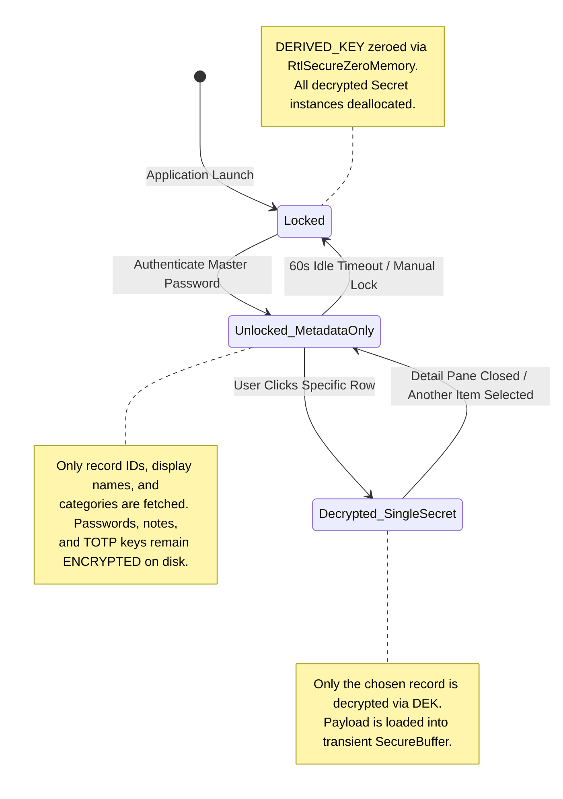

---

### Atomic Crash-Safe Migrations (`StorageMigrator`)

When an operator upgrades from legacy flat-file storage (`.simpleCredentialManager.secret` and `.metadata`) to SQLite, `StorageMigrator.py` guarantees zero data loss through multi-stage staging:

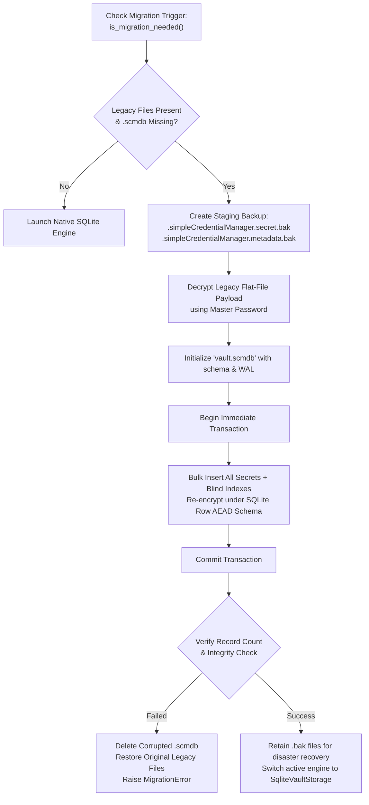

---

## 4. Desktop Interface & Security Superpowers

### PySide6 Three-Pane Reactive Architecture

The modernized desktop client (`ModernMainWindow.py`) replaces legacy Tkinter dialogs with a Qt6-powered three-pane layout:

```
+-------------------+-----------------------------------+--------------------------------------------+
| 1. Sidebar Pane   | 2. Master Item List               | 3. Detail & Inspection Pane                |
| (Navigation)      | (Live Filter & Badges)            | (Field Decryption & Actions)               |
+-------------------+-----------------------------------+--------------------------------------------+
| [@] All Items     | [ Search vault... (Ctrl+F)    ]   | Secret: github.com                         |
| [*] Favorites     | +-------------------------------+ | Category: Developer Tools                  |
| [#] Categories    | | [F] github.com                | |                                            |
|   - Personal (12) | |     user@example.com          | | Username: dev-user           [ Copy ]    |
|   - Work (45)     | |-------------------------------| | Password: ••••••••••••••••   [ Show ][Copy]|
|   - Finance (8)   | | [ ] aws-production            | |                                            |
|                   | |     ops-admin                 | | TOTP Code: 849 201   (14s) [ Copy ]      |
| [!] Security      | |-------------------------------| |   (Circular Progress Arc: 46% remaining) |
|   - Health Score  | | [ ] personal-banking          | | URL: https://github.com/login [ Open ]   |
|   - Breached (1)  | |     client-id                 | | Notes: Stored recovery codes...          |
|   - Weak (4)      | +-------------------------------+ | Created: 2026-03-12  Updated: 2026-10-29   |
+-------------------+-----------------------------------+--------------------------------------------+
```

---

### Dynamic QSS Theming Engine

`Themes.py` provides high-contrast, accessibility-tested Qt Style Sheets (QSS) adhering to WCAG 2.1 AA contrast requirements:

```css
/* Excerpt: SCM Dark Slate QSS Palette */
QMainWindow, QDialog {
    background-color: #1a1d24;
    color: #e1e4ea;
}
QListWidget {
    background-color: #21252e;
    border: 1px solid #2d3340;
    border-radius: 8px;
    padding: 4px;
}
QListWidget::item:selected {
    background-color: #3b82f6;
    color: #ffffff;
    border-radius: 6px;
}
QPushButton#copyButton {
    background-color: #2d3340;
    border: 1px solid #3b4252;
    border-radius: 6px;
    padding: 6px 14px;
    font-weight: 600;
}
QPushButton#copyButton:hover {
    background-color: #3b82f6;
    color: #ffffff;
}
```

---

### RFC 6238 / RFC 4226 TOTP Engine & Smooth Arc Visualization

SCM includes an integrated authenticator engine, eliminating dependence on secondary phone apps.

#### TOTP Mathematics
The Time-Based One-Time Password algorithm derives from HMAC-Based One-Time Passwords (HOTP, RFC 4226) over discrete $T_0$ time steps:

$$T = \left\lfloor \frac{\text{UnixTime}() - T_0}{X} \right\rfloor \quad (\text{where } X = 30\text{ seconds})$$

$$\text{HMAC-Value} = \text{HMAC-SHA1}_{K_{\text{secret}}}(T)$$

$$\text{Offset} = \text{HMAC-Value}[19] \land \text{0x0F}$$

$$\text{Code} = (\text{HMAC-Value}[\text{Offset} : \text{Offset}+4] \land \text{0x7FFFFFFF}) \bmod 10^6$$

#### Smooth Arc Visualization Widget
`TotpCountdownWidget.py` renders an animated circular sweep arc tracking the remaining seconds:

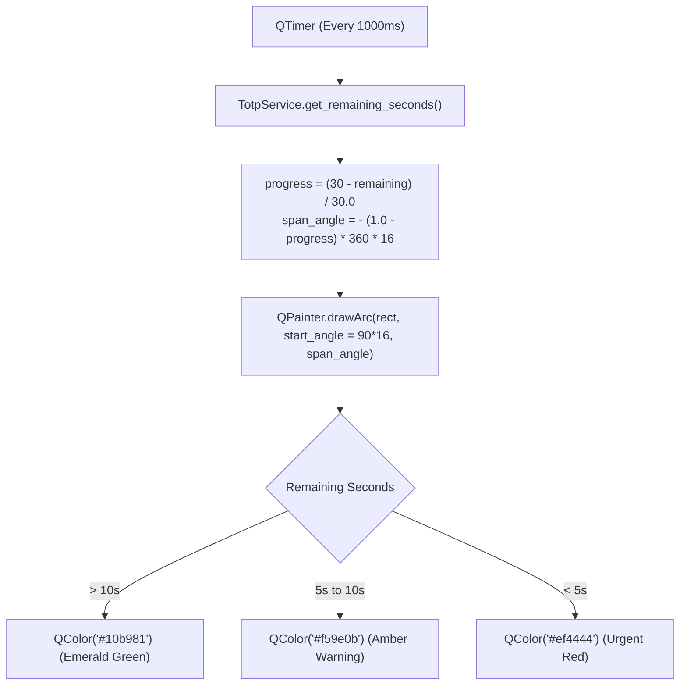

---

### Password Health Scoring & HIBP k-Anonymity Protocol

`PasswordHealthService.py` calculates real-time vault posture using a multi-factor penalty algorithm:

$$\text{HealthScore} = \max\left(0, 100 - P_{\text{weak}} - P_{\text{reused}} - P_{\text{stale}} - P_{\text{breached}}\right)$$

#### Penalty Weights
- **Weak Password Penalty ($P_{\text{weak}}$)**: $15$ points deducted per credential with Shannon entropy $< 45\text{ bits}$ or length $< 12\text{ chars}$.
- **Reused Password Penalty ($P_{\text{reused}}$)**: $20$ points deducted for each password hash duplicated across multiple distinct services.
- **Stale Password Penalty ($P_{\text{stale}}$)**: $5$ points deducted per credential unrotated for $> 365\text{ days}$.
- **Breached Password Penalty ($P_{\text{breached}}$)**: $30$ points deducted per credential detected in public compromise dumps.

#### HaveIBeenPwned k-Anonymity Model
SCM checks passwords against $>800$ million breached credentials without ever exposing the password or full hash across the network:

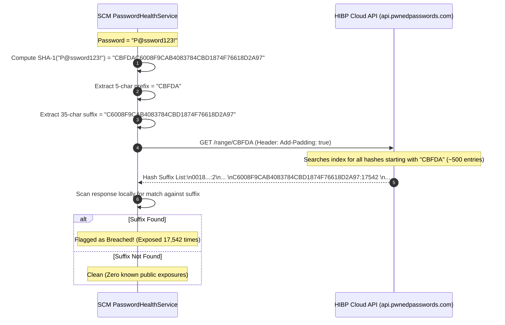

---

## 5. Modern CLI Architecture

### Typer & Rich Command Tree

SCM ships with a full-featured terminal CLI built on **Typer** and **Rich** (`ModernCli.py`):

```
scm
├── unlock               # Authenticates session and primes memory
├── list                 # Tabular output of vault records
├── get <name>           # Retrieve record fields
│   ├── --copy / -c      # Send password to zero-trace clipboard
│   ├── --totp / -t      # Output active TOTP code
│   └── --reveal / -r    # Unmask password to stdout
├── add                  # Interactive or flagged secret creation
│   ├── --name / -n
│   ├── --user / -u
│   ├── --password / -p
│   ├── --url
│   └── --totp-key
├── update <name>        # Mutate specific secret fields
├── delete <name>        # Remove secret with confirmation prompt
├── health               # Comprehensive audit summary & score
├── totp <name>          # Continuous or single-shot 2FA token generation
└── export / import      # Encrypted (.scmbackup) and plain CSV data exchange
```

---

### UNIX Piping, POSIX Flags & Headless JSON Pipelines

For scripting, CI/CD runners, and headless automation, every reading command supports machine-readable output:

```bash
# Retrieve decrypted password directly into a subshell variable
TOKEN=$(scm get "github-pat" --reveal --field password)

# Output raw JSON representation for jq filtering
scm list --json | jq '.[] | select(.category == "Infrastructure") | .name'

# Generate instantaneous TOTP token for automated curl auth
curl -H "X-MFA: $(scm totp "aws-root" --raw)" https://internal.corp.com/api
```

---

## 6. Threat Model & Security Boundary Analysis

### Attacker Capability Matrix

| Attacker Profile | Threat Description | Inherent Risk | SCM Mitigation Mechanism |
|---|---|---|---|
| **Local File Stealer** | Attacker extracts `vault.scmdb` from disk or backup image | High | Argon2id KDF ($64\text{ MiB}, 3\text{ passes}$) + AES-256-GCM envelope encryption. |
| **Memory Dumper** | Local malware / root process executes core dump or inspects swap | Medium | Lazy single-record decryption; `SecureBuffer` zeroes memory upon context exit. |
| **Clipboard Snooper** | Malicious app monitors OS clipboard history | Medium | Registers `ExcludeClipboardContentFromMonitorProcessing`; SHA-256 auto-clear timer. |
| **Shoulder Surfer** | Direct visual eavesdropping on desktop monitor | Low | Password fields default to bullet masking (`••••••••`); clipboard click-to-copy eliminates typing. |
| **Database Corruptor** | Sudden machine power failure or kernel panic during write | Medium | SQLite Write-Ahead Logging (`WAL`) with ACID atomic commits. |

---

### Offline Brute-Force Cost & Work Factor Calculations

If an attacker captures `vault.scmdb` and `.metadata`, they must brute-force the Master Key ($K_M$) offline.

#### Work Factor Comparison: Scrypt vs. Argon2id vs. Fast Hashes

| KDF / Algorithm | Memory per Guess | Hash Rate (High-End RTX 4090 GPU) | Cost to Crack 10-char Password ($62^{10} \approx 8.39 \times 10^{17}$ combinations) |
|---|---|---|---|
| **MD5 / SHA-256** | $\approx 0\text{ MB}$ | $> 25,000,000,000\text{ keys/sec}$ | $\approx 11.2\text{ months}$ ($1\times\text{ GPU}$) |
| **Scrypt ($N=16384, r=8, p=1$)** | $16\text{ MiB}$ | $\approx 15,000\text{ keys/sec}$ | $\approx 1,770,000\text{ years}$ |
| **Argon2id ($m=64\text{MB}, t=3, p=4$)** | **$64\text{ MiB}$** | **$\approx 380\text{ keys/sec}$** | **$> 70,000,000\text{ years}$** |

Because an RTX 4090 possesses $24\text{ GB}$ of VRAM, it can fit at most $\lfloor 24,576\text{ MB} / 64\text{ MB} \rfloor \approx 384$ concurrent Argon2id execution contexts. This hard physical memory barrier prevents parallel scaling and neutralizes cloud ASIC cracking farms.

---

### RAM Dumping & Cold-Boot Resistance

1. **Short Inactivity Window**: `SESSION_IDLE_LOCK_SECONDS = 60` zeroes out `DERIVED_KEY` after $60$ seconds of inactivity.
2. **Deterministic Memory Erasure**: When a session locks, `clear_derived_key()` calls `zero_buffer()`, which invokes `ctypes.windll.kernel32.RtlSecureZeroMemory` or POSIX `libc.explicit_bzero`.
3. **Transient Plaintext Exposure**: Decrypted secrets are never pooled in a persistent array. Only the currently viewed item in the detail pane exists in RAM.

---

### Residual Risks & Defense-in-Depth Mitigation

1. **Kernel-Level Keyloggers**:
   - *Risk*: A compromised operating system running a ring-0 rootkit can capture the master password during input.
   - *Mitigation*: Run SCM on fully patched, full-disk-encrypted (BitLocker / LUKS / FileVault) operating systems.
2. **OS Swap / Paging Files**:
   - *Risk*: Operating system virtual memory managers can swap dirty process pages to disk before explicit zeroing occurs.
   - *Mitigation*: Ensure the operating system enforces encrypted swap, or disable swap file usage on dedicated security workstations.
3. **Master Password Loss**:
   - *Risk*: SCM features **zero backdoors**. If the master password is forgotten, vault data cannot be recovered by anyone under any circumstances.
   - *Mitigation*: Users are instructed to store an emergency offline physical backup sheet (e.g., in a fireproof safe).
