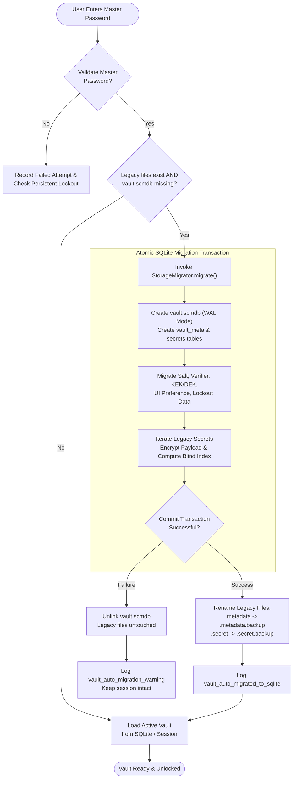

# Simple Credential Manager — Migration Guide (v2.0.8 to v3.0.0)

This comprehensive guide details the upgrade path, storage evolution, cryptographic transition, and automated migration mechanisms implemented in **Simple Credential Manager (SCM) v3.0.0**.

Whether you are an end-user upgrading an existing credential vault or a developer integrating or maintaining SCM components, this document provides the architectural and operational details needed to verify, understand, and troubleshoot the transition.

---

## Table of Contents

1. [Overview of the v2 to v3 Transition](#1-overview-of-the-v2-to-v3-transition)
   - [Legacy Flat-File Storage vs. Modern SQLite WAL Format](#legacy-flat-file-storage-vs-modern-sqlite-wal-format)
   - [Cryptographic Upgrade & Key Derivation Hierarchy](#cryptographic-upgrade--key-derivation-hierarchy)
   - [Architectural Comparison Matrix](#architectural-comparison-matrix)
2. [How the Auto-Migration Process Works](#2-how-the-auto-migration-process-works)
   - [Zero-Configuration Automatic Execution](#zero-configuration-automatic-execution)
   - [Atomic Transaction Wrapping](#atomic-transaction-wrapping)
   - [Preservation of Legacy Files (.backup Safeguard)](#preservation-of-legacy-files-backup-safeguard)
   - [Crash Resilience & Rollback Mechanics](#crash-resilience--rollback-mechanics)
   - [Migration Flow Diagram](#migration-flow-diagram)
3. [What is Migrated & Preserved](#3-what-is-migrated--preserved)
   - [Credential Payload Attributes](#credential-payload-attributes)
   - [Vault Security & State Metadata](#vault-security--state-metadata)
4. [Post-Migration Verification & Fallback](#4-post-migration-verification--fallback)
   - [Verification via Modern Desktop UI (PySide6)](#verification-via-modern-desktop-ui-pyside6)
   - [Verification via Modern Interactive / Headless CLI (Typer + Rich)](#verification-via-modern-interactive--headless-cli-typer--rich)
   - [Filesystem Layout Inspection](#filesystem-layout-inspection)
   - [Manual Rollback & Disaster Recovery Procedure](#manual-rollback--disaster-recovery-procedure)
5. [Code References & Architecture Links](#5-code-references--architecture-links)

---

## 1. Overview of the v2 to v3 Transition

In versions **v2.0.8 and earlier**, Simple Credential Manager relied on a dual flat-file storage format with whole-file encryption. While lightweight, whole-file serialization suffered from scaling limitations, coarse-grained disk writes, and risk of file corruption during abrupt shutdowns.

**Version 3.0.0** introduces a high-performance, embedded row-level SQLite storage engine with Write-Ahead Logging (WAL) and an enterprise-grade cryptographic envelope architecture.

### Legacy Flat-File Storage vs. Modern SQLite WAL Format

| Aspect | Legacy Storage (v2.0.8) | Modern SQLite WAL Storage (v3.0.0) |
|---|---|---|
| **Primary Data Store** | `~/.simpleCredentialManager/.simpleCredentialManager.secret` | `~/.simpleCredentialManager/vault.scmdb` |
| **Metadata Store** | `~/.config/.simpleCredentialManager/.simpleCredentialManager.metadata` | Embedded `vault_meta` table in `vault.scmdb` |
| **Storage Architecture** | Flat JSON serialized file encrypted in a single monolithic blob | Relational SQLite with Write-Ahead Logging (`PRAGMA journal_mode = WAL`) |
| **Encryption Granularity** | Monolithic: Entire vault file re-encrypted on every single secret save/edit | Row-Level: Each secret name, username, and payload encrypted individually |
| **Read/Write Complexity** | $O(N)$ memory and disk I/O on every write operation | $O(1)$ indexed reads and atomic row insertions |
| **Search & Indexing** | Requires decrypting every secret in memory to search or list | Deterministic HMAC-SHA256 Blind Indexing (`idx_secrets_blind`) |
| **Concurrent Reads** | Subject to file-locking conflicts | SQLite WAL permits non-blocking concurrent readers during writes |

### Cryptographic Upgrade & Key Derivation Hierarchy

#### 1. Key Derivation Function (KDF)
- **Legacy (v2.x)**: Used **Scrypt** ($N = 16384, r = 8, p = 1$) to derive a 64-byte split material (32-byte verifier + 32-byte Fernet vault key).
- **Modern (v3.0.0)**: Upgrades to **Argon2id** (`argon2.low_level.hash_secret_raw`) with memory-hard parameters ($m = 65536\text{ KB} / 64\text{ MB}$, $t = 3\text{ iterations}$, $p = 4\text{ parallel threads}$), delivering superior resistance against ASIC and GPU-accelerated dictionary attacks. Graceful fallback to Scrypt is maintained if `argon2-cffi` is unavailable in the environment.

#### 2. Two-Tier Envelope Encryption (KEK / DEK Hierarchy)
- **Legacy (v2.x)**: Directly derived the vault encryption key from the master password. Changing the master password required full vault re-encryption of all secret entries.
- **Modern (v3.0.0)**: Employs a **Two-Tier Envelope Key Hierarchy**:
  1. **Master Key ($K_M$)**: Derived from the user's master password via Argon2id (or Scrypt fallback).
  2. **Key Encryption Key (KEK)**: Derived via `HKDFExpand(SHA256, info=b"scm-envelope-kek-v1", length=32)`.
  3. **Auth Key**: Derived via `HKDFExpand(SHA256, info=b"scm-envelope-auth-v1", length=32)`.
  4. **Data Encryption Key (DEK)**: A high-entropy 256-bit random key generated via system CSPRNG (`secrets.token_bytes(32)`), wrapped under the KEK using `AES-256-GCM` with a 96-bit random nonce.
  5. **Blind Index Key**: Derived from the DEK via `HKDFExpand(SHA256, info=b"scm-blind-index-key-v1", length=32)`.

> [!TIP]
> **Sub-Millisecond Master Password Changes**: Because row-level credentials are encrypted under the DEK rather than directly with the user's master password, changing your master password in v3.0.0 re-wraps only the 32-byte DEK envelope inside `vault_meta`. None of your individual credential rows need to be decrypted or re-encrypted on disk.

#### 3. Searchable Blind Indexing
- Under v3.0.0, secret titles are indexed via deterministic HMAC-SHA256 blind indexes (`compute_blind_index(name, blind_key)`). This enables instant $O(1)$ credential queries by exact name without revealing secret names in plaintext on disk or leaking plaintext prefixes to disk forecasters.

---

## 2. How the Auto-Migration Process Works

Simple Credential Manager v3.0.0 provides a completely seamless, zero-touch upgrade path. Existing v2.x users do not need to export unencrypted CSV files or manually execute command-line conversion tools.

### Zero-Configuration Automatic Execution
The migration process is integrated into the core service lifecycle inside [`SecretManagerService.authenticate()`](file:///C:/Workspace/git/SimpleCredentialManager/dev/abhishekraha/secretmanager/core/SecretManagerService.py#L133-L144):
1. The user opens the Modern PySide6 Desktop UI or Modern Typer CLI and enters their master password.
2. `SecretManagerService` checks [`StorageMigrator.is_migration_needed()`](file:///C:/Workspace/git/SimpleCredentialManager/dev/abhishekraha/secretmanager/storage/StorageMigrator.py#L53-L60), which inspects the local storage paths:
   - Does a legacy metadata or secret file exist? (`.simpleCredentialManager.metadata` or `.simpleCredentialManager.secret`)
   - Is `vault.scmdb` absent?
3. If both conditions are satisfied, `StorageMigrator.migrate(master_password)` executes automatically before completing authentication.

### Atomic Transaction Wrapping
Data integrity is protected by SQLite's ACID guarantees:
1. `StorageMigrator` boots a connection to `vault.scmdb` with `PRAGMA journal_mode = WAL;`.
2. Tables `vault_meta` and `secrets` are created with corresponding indexes.
3. The metadata, wrapped DEK, salt, lockout counters, and UI preferences are initialized in `vault_meta`.
4. All secrets from the legacy vault are decrypted into transient memory and inserted row-by-row into `secrets` with AES-GCM / Fernet payload encryption and HMAC blind indexing.
5. All insertions occur inside an **atomic SQLite transaction context** (`with conn:`). If any record fails or the process is interrupted, the transaction immediately rolls back and the target database is deleted.

### Preservation of Legacy Files (`.backup` Safeguard)
To guarantee zero risk of data loss, legacy flat files are **never deleted**. After the SQLite transaction successfully commits:
- `~/.config/.simpleCredentialManager/.simpleCredentialManager.metadata` is atomically renamed to:
  `~/.config/.simpleCredentialManager/.simpleCredentialManager.metadata.backup`
- `~/.simpleCredentialManager/.simpleCredentialManager.secret` is atomically renamed to:
  `~/.simpleCredentialManager/.simpleCredentialManager.secret.backup`

### Crash Resilience & Rollback Mechanics
- **Failed Decryption**: If an incorrect master password is submitted, migration aborts before any filesystem writes occur.
- **Interrupted Migration**: If an unhandled exception or power failure occurs during transfer:
  - The incomplete `vault.scmdb` file is unlinked (`unlink(missing_ok=True)`).
  - The original legacy `.metadata` and `.secret` files remain untouched in their original locations.
  - The user's active session is not blocked; warning audits are dispatched (`vault_auto_migration_warning`), allowing continued operation while preserving existing files.

### Migration Flow Diagram



---

## 3. What is Migrated & Preserved

The migration guarantees 100% data fidelity between v2.x and v3.x schemas.

### Credential Payload Attributes
Every single credential record is translated into a `Secret` model instance and preserved in the `secrets` table:

| Attribute | v2.x Representation | v3.0.0 SQLite Representation | Notes |
|---|---|---|---|
| **Name / Identifier** | Dictionary key & `Secret.name` | `blind_index` + `name_encrypted` | Searchable via HMAC-SHA256 blind index |
| **Username** | `Secret.username` | `username_encrypted` | Encrypted row payload |
| **Password** | `Secret.password` | Encrypted in `payload_encrypted` | Encrypted row payload |
| **URL / Website** | `Secret.url` | Encrypted in `payload_encrypted` | Encrypted row payload |
| **Notes / Comments** | `Secret.comments` | Encrypted in `payload_encrypted` | Encrypted row payload |
| **Category** | `Secret.category` (default `"login"`) | Column `category` + payload | Preserves `"login"`, `"card"`, `"server"`, etc. |
| **Favorite Status** | `Secret.is_favorite` (boolean) | Column `is_favorite` (INTEGER 0/1) | Indexed for fast filtering |
| **2FA / TOTP Secret** | `Secret.totp_secret` (URI or base32) | Encrypted in `payload_encrypted` | Compatible with RFC 6238 countdown arc |
| **Tags** | `Secret.tags` (list of strings) | Encrypted in `payload_encrypted` | Preserved in JSON payload |
| **Creation Timestamp** | `Secret.create_date` | Column `created_at` + payload | ISO 8601 string |
| **Modification Timestamp** | `Secret.update_date` | Column `updated_at` + payload | ISO 8601 string |

### Vault Security & State Metadata
All operational parameters stored in `.simpleCredentialManager.metadata` are transferred to the `vault_meta` table:
- **Salt**: Cryptographic salt for master key derivation.
- **KDF Parameters**: Active KDF version and algorithm settings (`argon2id` or `scrypt`).
- **Two-Tier Envelope**: Wrapped Data Encryption Key (DEK).
- **Lockout State**: Persistent failed authentication attempt count and any active lockout expiration timestamp (`lockout_until`).
- **UI Preferences**: User's chosen interface theme or view preference (`modern` vs. `classic`).

---

## 4. Post-Migration Verification & Fallback

### Verification via Modern Desktop UI (PySide6)
1. Launch the Modern GUI:
   ```bash
   python SimpleCredentialManagerUi.py
   ```
2. Enter your master password at the startup prompt.
3. Observe the UI:
   - All credentials should populate immediately in the credential list.
   - Category tags, favorites, and notes will match your previous vault state.
   - Selecting any credential with a TOTP secret will activate the live RFC 6238 countdown arc widget.
   - Click **Security Audit** in the left sidebar to confirm that the **Password Health Score**, duplicate detection, and weak password auditing accurately inspect your migrated vault.

### Verification via Modern Interactive / Headless CLI (Typer + Rich)
1. Run `scm list` (or the direct entry point) to view all credentials in the styled terminal table:
   ```bash
   python SimpleCredentialManagerCli.py list
   ```
2. Test retrieving a specific credential:
   ```bash
   python SimpleCredentialManagerCli.py get <secret-name>
   ```
3. Check overall vault health and entropy:
   ```bash
   python SimpleCredentialManagerCli.py health
   ```

### Filesystem Layout Inspection
Following a successful migration, your user directories will reflect the following layout:

```text
~/.simpleCredentialManager/
├── vault.scmdb                 <-- Primary SQLite database (Row-level AEAD)
├── vault.scmdb-wal             <-- SQLite Write-Ahead Log (active during open sessions)
├── vault.scmdb-shm             <-- SQLite shared memory index
└── .simpleCredentialManager.secret.backup   <-- Preserved legacy encrypted secret file

~/.config/.simpleCredentialManager/
├── .simpleCredentialManager.metadata.backup <-- Preserved legacy metadata file
├── .simpleCredentialManager.audit.log        <-- Append-only JSONL security audit trail
└── .simpleCredentialManager.release-status.json
```

To confirm the presence of the migration event in the audit trail:
- Open `~/.config/.simpleCredentialManager/.simpleCredentialManager.audit.log`
- Look for the event entry:
  ```json
  {"action": "vault_auto_migrated_to_sqlite", "count": <num_secrets>, "timestamp": "..."}
  ```

### Manual Rollback & Disaster Recovery Procedure
Because the migration process retains full `.backup` copies of legacy files, you can roll back to the v2 flat-file format at any time if required for troubleshooting or backward compatibility testing:

> [!CAUTION]
> If you added new credentials or updated passwords in v3.0.0 **after** migration, those new modifications are stored inside `vault.scmdb`. Rolling back to `.backup` files will restore the vault state as it existed at the instant of migration. Export an encrypted backup (`scm export` or Modern UI export) before performing manual rollbacks.

#### Rollback Steps:
1. Ensure all SCM GUI and CLI processes are closed.
2. Remove the SQLite database and its WAL temporary files:
   ```bash
   # Linux / macOS
   rm ~/.simpleCredentialManager/vault.scmdb*
   
   # Windows PowerShell
   Remove-Item "$HOME\.simpleCredentialManager\vault.scmdb*" -Force
   ```
3. Restore the backup files to their canonical names:
   ```bash
   # Linux / macOS
   mv ~/.simpleCredentialManager/.simpleCredentialManager.secret.backup \
      ~/.simpleCredentialManager/.simpleCredentialManager.secret
      
   mv ~/.config/.simpleCredentialManager/.simpleCredentialManager.metadata.backup \
      ~/.config/.simpleCredentialManager/.simpleCredentialManager.metadata
      
   # Windows PowerShell
   Rename-Item "$HOME\.simpleCredentialManager\.simpleCredentialManager.secret.backup" ".simpleCredentialManager.secret"
   Rename-Item "$HOME\.config\.simpleCredentialManager\.simpleCredentialManager.metadata.backup" ".simpleCredentialManager.metadata"
   ```
4. To launch using the legacy engine without triggering auto-migration to SQLite, pass `--classic` or `--legacy`:
   ```bash
   python SimpleCredentialManagerUi.py --classic
   # or
   python SimpleCredentialManagerCli.py --legacy
   ```

---

## 5. Code References & Architecture Links

For developers maintaining or extending SCM storage and migration features, refer to the following codebase modules:

- [`StorageMigrator.py`](file:///C:/Workspace/git/SimpleCredentialManager/dev/abhishekraha/secretmanager/storage/StorageMigrator.py): Encapsulates detection (`is_migration_needed`), atomic migration transactions, error cleanup, and `.backup` file renames.
- [`SqliteVaultStorage.py`](file:///C:/Workspace/git/SimpleCredentialManager/dev/abhishekraha/secretmanager/storage/SqliteVaultStorage.py): Core SQLite WAL storage engine implementing row-level AEAD ciphers, HMAC-SHA256 blind indexing, and metadata operations.
- [`SecretManagerService.py`](file:///C:/Workspace/git/SimpleCredentialManager/dev/abhishekraha/secretmanager/core/SecretManagerService.py): Main facade coordinating authentication, auto-migration triggers, lockout escalation, and credential operations.
- [`CodecUtils.py`](file:///C:/Workspace/git/SimpleCredentialManager/dev/abhishekraha/secretmanager/codec/CodecUtils.py): Cryptographic primitives including Argon2id / Scrypt KDFs, HKDF envelope key derivation, and blind index generation.
- [`SecureBuffer.py`](file:///C:/Workspace/git/SimpleCredentialManager/dev/abhishekraha/secretmanager/utils/SecureBuffer.py): C-style memory zeroing utilities protecting master passwords and DEK handles in RAM.
- [`ARCHITECTURE_DEEP_DIVE.md`](file:///C:/Workspace/git/SimpleCredentialManager/docs/ARCHITECTURE_DEEP_DIVE.md): Full technical deep dive into SCM threat modeling, cryptographic specifications, and UI internals.
