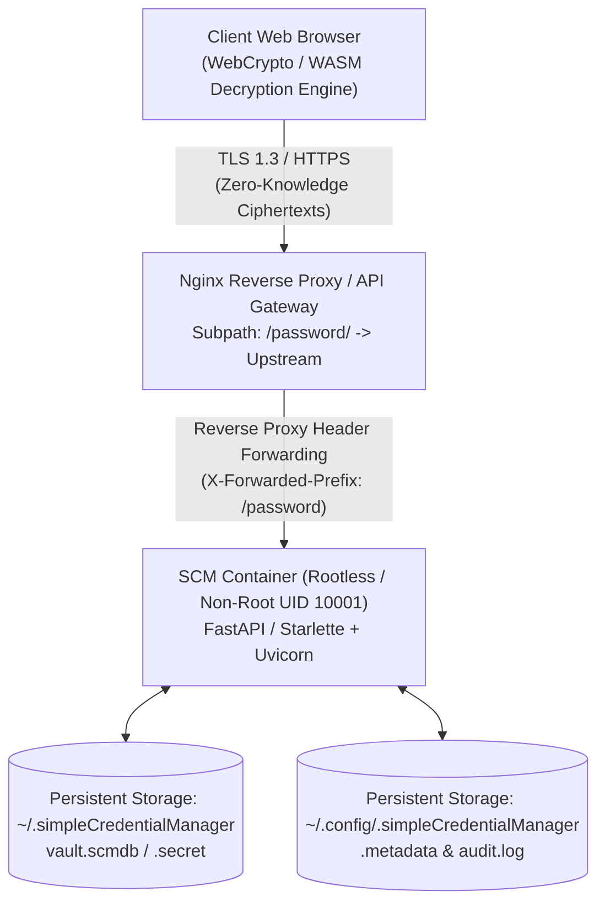
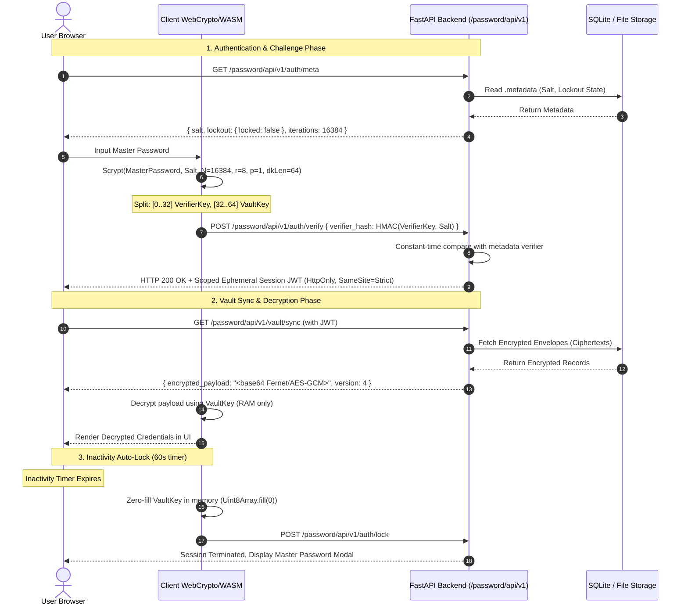

# Architecture & Implementation Plan: SCM Server Mode
**Web Application, Containerization, and Nginx Subpath Reverse Proxy Integration (`/password/`)**

**Status:** Proposed Architecture  
**Author:** Principal Cloud & Security Architect  
**Target Repository:** `SimpleCredentialManager`  
**Document Version:** 1.0.0  
**Date:** October 2026  

---

## Executive Summary

Simple Credential Manager (SCM) currently operates as a dual-interface desktop application (interactive CLI & Tkinter UI) storing credentials in an encrypted local envelope on disk (`~/.simpleCredentialManager` and `~/.config/.simpleCredentialManager`).

This architectural plan defines **SCM Server Mode**: transforming SCM into a lightweight, high-performance, containerized web service accessible behind standard reverse proxies (specifically designed for enterprise deployments mounted at subpaths such as `https://gateway.internal/password/`). 

The design maintains SCM's uncompromising security posture:
- **Zero-Knowledge Web Architecture**: Cryptographic isolation ensuring master passwords and plaintext secret payloads are never transmitted across the network or stored unencrypted in server memory.
- **Enterprise Containerization**: Distroless/Alpine rootless container design with minimal attack surface, OCI compliance, and standard health probing.
- **Dynamic Reverse Proxy Compatibility**: Deep subpath routing (`/password/`) support via standard Nginx headers, dynamic base href calculation, and WebSocket/SSE support for real-time lockout synchronization.



---

## 1. System Architecture & Framework Selection

### 1.1 Backend Framework: FastAPI + Starlette (Uvicorn ASGI)

For the server runtime, **FastAPI** on top of **Starlette** and **Uvicorn** is selected:
1. **Asynchronous I/O Performance**: High concurrency with non-blocking I/O for API endpoints and Server-Sent Events (SSE) / WebSockets.
2. **Strict OpenAPI Schema Contracts**: Pydantic v2 schemas enforce validation and prevent injection or type-juggling attacks.
3. **Mount Compatibility**: Native support for ASGI `root_path` handling, critical for subpath proxying under `/password/`.
4. **Minimal Footprint**: Low memory footprint (~35MB baseline RAM), aligning with SCM's lightweight ethos.

### 1.2 Frontend Architecture: Reactive Modern SPA with WebCrypto & WASM

To achieve **Zero-Knowledge**, client-side decryption is mandatory. A standard server-rendered architecture (Jinja2/HTMX) would require the server to hold decrypted secrets in memory, exposing plaintext to server memory dumps, compromise, or malicious inspection.

| Consideration | Server-Rendered (Jinja2/HTMX) | Client-Side Decrypted SPA (Vite + React / Svelte) |
|---|---|---|
| **Zero-Knowledge** | ❌ Impossible (Server must decrypt) | ✅ Native (Decrypted exclusively in browser memory) |
| **Master Password Exposure** | ❌ Master password sent to server over wire | ✅ Never leaves the client browser sandbox |
| **Server Memory Breach Impact** | ❌ Attacker dumps memory to steal plaintexts | ✅ Attacker only gets ciphertext envelopes |
| **Offline / Ephemeral Caching** | ❌ Every view requires server trip | ✅ In-memory ephemeral decrypted session cache |

**Frontend Stack**:
- Modern single-page app (Vite + React/TypeScript or Vanilla TS) compiled into static assets served directly by FastAPI or Nginx.
- UI styling consistent with SCM's modern dark theme UI.
- Direct integration with W3C standard **Web Cryptography API (`window.crypto.subtle`)** and Scrypt WASM for client-side key derivation.

---

## 2. Zero-Knowledge Cryptography & Web Security Model

### 2.1 The Two Operational Modes

To support both enterprise air-gapped environments and zero-trust web deployments, SCM Server Mode supports two cryptographic operating modes configured via `SCM_SECURITY_MODE`:

1. **Client-Side Zero-Knowledge Mode (`zero-knowledge`) [Default]**:
   - Master password **never** leaves the client's browser.
   - Key derivation (Scrypt / Argon2id) executes inside the browser via WebAssembly (`scrypt-js` or `@noble/hashes`).
   - The server only stores and serves encrypted blobs (envelopes) and metadata (salt, verifier, lockout counters).
2. **Server-Assisted Ephemeral Session Mode (`server-session`) [Optional for legacy/headless clients]**:
   - Master password sent over TLS to server.
   - KDF executed in Python; ephemeral Fernet key retained in memory-only cache tied to an encrypted HttpOnly cookie.
   - Cleared automatically on idle timeout (60 seconds) or server shutdown.

### 2.2 Detailed Zero-Knowledge Cryptographic Flow



### 2.3 Ephemeral Memory Sanitization & Session Management
- **In-Memory Key Zeroing**: Keys held in typed arrays (`Uint8Array`) are explicitly zeroed out (`buffer.fill(0)`) upon vault lock, page unload (`beforeunload`), or after 60 seconds of idle time.
- **Session Tokens**: JWT tokens are signed with an ephemeral in-memory secret generated at server boot (`secrets.token_hex(32)`). Restarting the container invalidates all active web sessions immediately.
- **Lockout Enforcement**: Lockout attempts are tracked server-side in SQLite/metadata with exponential backoff ($30s \rightarrow 900s$) to eliminate brute-force web attacks.

---

## 3. Containerization Strategy (Docker & OCI)

### 3.1 Hardened Multi-Stage Dockerfile

The container image utilizes a multi-stage build:
1. `builder` stage: Installs build dependencies (gcc, libffi-dev), compiles Python wheels.
2. `frontend-builder` stage: Compiles the React/TS WebCrypto client into optimized static assets.
3. `runtime` stage: Uses `python:3.12-alpine` or `python:3.12-slim-bookworm`, runs as an unprivileged user (`uid:gid = 10001:10001`), drops all Linux capabilities, and uses a read-only root filesystem with explicit tmpfs mounts.

#### File: `Dockerfile`
```dockerfile
# =====================================================================
# Stage 1: Build Frontend SPA
# =====================================================================
FROM node:20-alpine AS frontend-builder
WORKDIR /web
COPY web/package*.json ./
RUN npm ci --quiet
COPY web/ ./
RUN npm run build

# =====================================================================
# Stage 2: Build Python Wheels & Dependencies
# =====================================================================
FROM python:3.12-alpine AS builder

WORKDIR /build
RUN apk add --no-cache gcc musl-dev libffi-dev cargo openssl-dev

COPY requirements.txt .
RUN pip install --no-cache-dir --upgrade pip && \
    pip wheel --no-cache-dir --no-deps --wheel-dir /build/wheels -r requirements.txt

# =====================================================================
# Stage 3: Secure Unprivileged Runtime
# =====================================================================
FROM python:3.12-alpine AS runner

# Install runtime dependencies only
RUN apk add --no-cache libffi openssl tzdata curl && \
    addgroup -g 10001 scm && \
    adduser -u 10001 -G scm -s /sbin/nologin -D -H scm

WORKDIR /app

# Copy built python packages
COPY --from=builder /build/wheels /wheels
RUN pip install --no-cache-dir /wheels/* && rm -rf /wheels

# Copy application source code
COPY dev /app/dev
COPY --from=frontend-builder /web/dist /app/dev/abhishekraha/secretmanager/server/static

# Create persistent storage directories with correct ownership
RUN mkdir -p /home/scm/.simpleCredentialManager \
             /home/scm/.config/.simpleCredentialManager && \
    chown -R scm:scm /home/scm /app

ENV PYTHONUNBUFFERED=1 \
    PYTHONDONTWRITEBYTECODE=1 \
    HOME=/home/scm \
    PORT=8080 \
    HOST=0.0.0.0 \
    SCM_ROOT_PATH=/password

USER 10001:10001

EXPOSE 8080

HEALTHCHECK --interval=30s --timeout=5s --start-period=10s --retries=3 \
    CMD curl -f http://127.0.0.1:8080${SCM_ROOT_PATH}/healthz || exit 1

ENTRYPOINT ["python", "-m", "dev.abhishekraha/secretmanager/server/main"]
```

### 3.2 Docker Compose Specification

Mounts host directories corresponding to SCM's native directories, preserving compatibility between CLI, desktop GUI, and server modes.

#### File: `docker-compose.yml`
```yaml
version: "3.8"

services:
  scm-server:
    build:
      context: .
      dockerfile: Dockerfile
    image: simple-credential-manager:latest
    container_name: scm-server
    restart: unless-stopped
    read_only: true
    tmpfs:
      - /tmp:rw,noexec,nosuid,size=64m
    environment:
      - SCM_ROOT_PATH=/password
      - SCM_SECURITY_MODE=zero-knowledge
      - SCM_IDLE_LOCK_SECONDS=60
      - LOG_LEVEL=INFO
    volumes:
      # Data volume (vault database, encrypted files)
      - ${HOME}/.simpleCredentialManager:/home/scm/.simpleCredentialManager:rw
      # Config volume (metadata, audit logs)
      - ${HOME}/.config/.simpleCredentialManager:/home/scm/.config/.simpleCredentialManager:rw
    ports:
      - "127.0.0.1:8080:8080"
    security_opt:
      - no-new-privileges:true
    cap_drop:
      - ALL
    healthcheck:
      test: ["CMD", "curl", "-f", "http://127.0.0.1:8080/password/healthz"]
      interval: 30s
      timeout: 5s
      retries: 3
      start_period: 10s
    logging:
      driver: "json-file"
      options:
        max-size: "10m"
        max-file: "3"
```

---

## 4. Nginx Reverse Proxy Integration (`/password/`)

### 4.1 Subpath Routing Challenges & Architectural Solutions

Routing a web application under a non-root subpath (e.g. `/password/`) introduces three critical architectural pitfalls:
1. **URI Rewrite vs Path Stripping**: If `proxy_pass http://upstream/;` is used, the URI is stripped of `/password/`. If `proxy_pass http://upstream;` (no trailing slash) is used, `/password/` is passed directly.
   - **Architectural Decision**: SCM backend will natively recognize `SCM_ROOT_PATH=/password` via ASGI `root_path`. Nginx will forward the request preserving `/password/` and explicitly providing the `X-Forwarded-Prefix` header.
2. **Asset Path Resolution**: Static assets (`/vite.svg`, `/assets/index.js`) must be fetched from `/password/assets/...`.
   - The frontend builder is configured with `base: './'` or `base: '/password/'`.
   - HTML injection provides dynamic `<base href="/password/">`.
3. **Redirect Loops**: Trailing slashes on `/password` must cleanly redirect to `/password/` without leaking upstream ports or internal hostnames.

### 4.2 Production Nginx Configuration Snippet

```nginx
# Upstream definition for SCM server container
upstream scm_backend {
    server 127.0.0.1:8080 max_fails=3 fail_timeout=10s;
    keepalive 32;
}

server {
    listen 443 ssl http2;
    server_name vault.example.com;

    # SSL Configuration
    ssl_certificate /etc/letsencrypt/live/vault.example.com/fullchain.pem;
    ssl_certificate_key /etc/letsencrypt/live/vault.example.com/privkey.pem;
    ssl_protocols TLSv1.2 TLSv1.3;
    ssl_ciphers ECDHE-ECDSA-AES128-GCM-SHA256:ECDHE-RSA-AES128-GCM-SHA256:ECDHE-ECDSA-AES256-GCM-SHA384;
    ssl_prefer_server_ciphers off;

    # Security Headers
    add_header Strict-Transport-Security "max-age=63072000; includeSubDomains; preload" always;
    add_header X-Content-Type-Options "nosniff" always;
    add_header X-Frame-Options "DENY" always;
    add_header Referrer-Policy "strict-origin-when-cross-origin" always;
    add_header Content-Security-Policy "default-src 'self'; script-src 'self' 'wasm-unsafe-eval'; style-src 'self' 'unsafe-inline'; img-src 'self' data:; connect-src 'self'; frame-ancestors 'none';" always;

    # Handle exact match without trailing slash -> Redirect to /password/
    location = /password {
        return 301 /password/;
    }

    # Main Subpath Routing
    location /password/ {
        # Proxy to ASGI backend
        proxy_pass http://scm_backend;
        
        # Standard Proxy Headers
        proxy_http_version 1.1;
        proxy_set_header Host $host;
        proxy_set_header X-Real-IP $remote_addr;
        proxy_set_header X-Forwarded-For $proxy_add_x_forwarded_for;
        proxy_set_header X-Forwarded-Proto $scheme;
        proxy_set_header X-Forwarded-Host $host;
        proxy_set_header X-Forwarded-Port $server_port;
        proxy_set_header X-Forwarded-Prefix /password;

        # WebSocket / Server-Sent Events (SSE) Support
        proxy_set_header Upgrade $http_upgrade;
        proxy_set_header Connection $connection_upgrade;

        # Timeouts and Buffering
        proxy_connect_timeout 5s;
        proxy_send_timeout 60s;
        proxy_read_timeout 60s;
        proxy_buffering off;
        proxy_cache_bypass $http_upgrade;
    }
}

# Required for dynamic WebSocket upgrade handling
map $http_upgrade $connection_upgrade {
    default upgrade;
    ''      close;
}
```

---

## 5. Server REST & WebSocket API Specification

SCM Server exposes a clean REST API mounted at `${SCM_ROOT_PATH}/api/v1`:

| Method | Endpoint | Description | Zero-Knowledge Payload |
|---|---|---|---|
| `GET` | `/healthz` | Container health probe | Status JSON (`{"status": "ok"}`) |
| `GET` | `/api/v1/meta` | Get vault state (initialized, lockout) | `{ initialized: bool, salt: b64, lockout: {...} }` |
| `POST` | `/api/v1/auth/setup` | First-time initialization | `{ salt: b64, verifier: b64, initial_vault: b64 }` |
| `POST` | `/api/v1/auth/challenge` | Request verification challenge | Constant-time challenge verification |
| `POST` | `/api/v1/auth/lock` | Invalidate current session token | Clears session cookie/revocation list |
| `GET` | `/api/v1/vault` | Fetch encrypted vault records | Returns encrypted payload ciphertext |
| `PUT` | `/api/v1/vault` | Atomic vault sync (commit encrypted changes) | Submits updated encrypted payload |
| `GET` | `/api/v1/audit/logs` | Fetch audit logs (last N events) | JSON array of sanitized audit entries |
| `GET` | `/api/v1/events` | SSE stream for real-time sync / lockout ticks | Server-Sent Events stream |

---

## 6. Implementation Roadmap & Phases

### Phase 1: Core ASGI Server & REST API (`dev/.../server/`)
1. Create `dev/abhishekraha/secretmanager/server/main.py` using FastAPI.
2. Implement routing with configurable `root_path`.
3. Wrap `SecretManagerService` and `SqliteVaultStorage` to expose thread-safe, non-blocking endpoints.
4. Implement atomic write locking for concurrent HTTP clients.

### Phase 2: Zero-Knowledge Web Interface (`web/`)
1. Scaffold lightweight Vite + TypeScript frontend.
2. Implement browser-native WebCrypto AES-GCM and Scrypt WASM wrapper.
3. Build responsive UI (Vault Unlock, Secret List/Search, Detail/Edit Modal, Password Generator).
4. Implement 60-second idle inactivity listener (`mousemove`, `keydown`, `touchstart`).

### Phase 3: Containerization & Automation
1. Author production `Dockerfile` (multi-stage, non-root user `10001`).
2. Add `docker-compose.yml` and `docker-compose.override.yml.example`.
3. Create automated smoke tests testing container startup, volume persistence, and permission checks.

### Phase 4: Nginx & Reverse Proxy Integration Documentation
1. Create sample `nginx/scm-subpath.conf`.
2. Add integration tests verifying subpath `/password/` URL rewrites, static assets, and WebSocket/SSE notifications.
3. Write end-to-end administrator guide in `docs/SERVER_MODE_DEPLOYMENT.md`.

---

## 7. Verification and Testing Strategy

- **Security Verification**: Automated tests verifying that no plaintext secret or master password ever appears in server access logs, audit logs, or error tracebacks.
- **Subpath Regression Tests**: Run tests via `httpx.AsyncClient` passing `root_path="/password"` to ensure all API routes and redirects preserve `/password/`.
- **Concurrency & Atomic Storage**: Concurrent PUT requests tested with optimistic concurrency control (`ETag` / `vault_version`) to prevent overwrite collisions.
